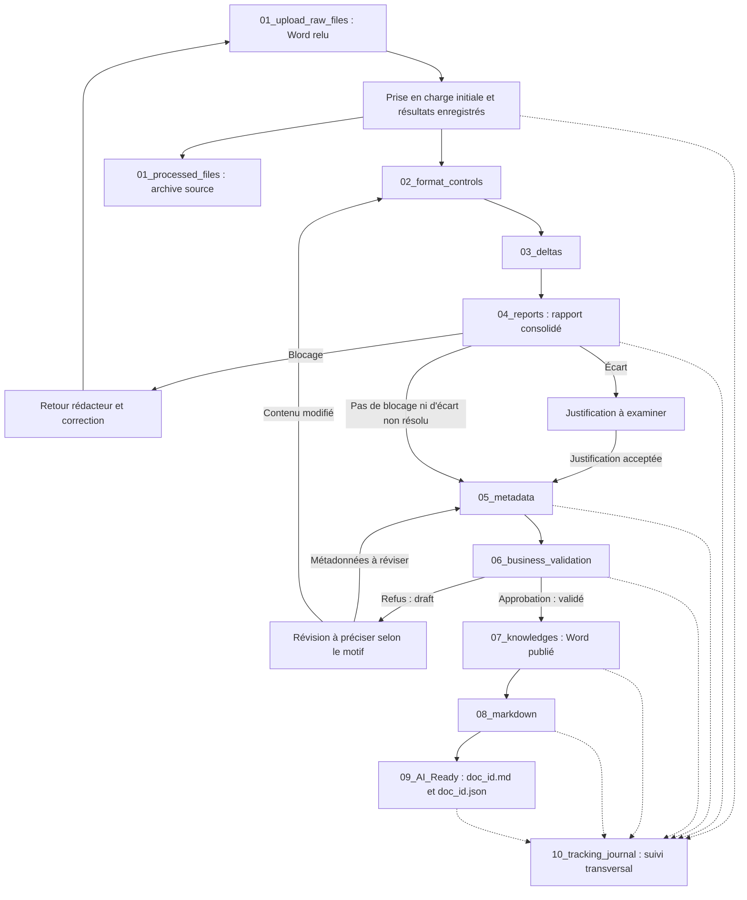

# Chaîne documentaire Knowledge Manager — `km`

Cette documentation décrit le fonctionnement cible du POC. L'interface de dépôt
est développée ; les dix autres pages restent provisoires. Les contrats n8n du
dépôt sont définis côté front, mais les chemins de webhooks restent vides et les
workflows ne sont pas créés. Aucun traitement métier ni connecteur n'est implémenté.

## Référence et périmètre

Le document [Poc_n8n.pdf](Poc_n8n.pdf) constitue la référence fonctionnelle :

- [Page 1](Poc_n8n.pdf#page=1) : objectif, parcours et premiers prérequis.
- [Page 2](Poc_n8n.pdf#page=2) : jeu de test, métadonnées, socle SharePoint,
  contrôles de format, proposition des métadonnées et validation métier.
- [Page 3](Poc_n8n.pdf#page=3) : archivage des versions, écarts, rapport consolidé,
  conversion Markdown, publication AI Ready et recette.
- [Page 4](Poc_n8n.pdf#page=4) : bilan, limites et recommandation cible.

Le périmètre retenu est le parcours d'un **Word relu**, depuis son dépôt jusqu'à
la publication du Markdown et de ses métadonnées dans AI Ready. Le titre du PDF
mentionne Sophia ; aucun contrat d'intégration avec Sophia n'y est fourni et
aucun raccordement n'est supposé dans ces fiches.

**Décision utilisateur :** le [dépôt des sources](01_upload_raw_files.md) est
désormais spécifié pour tous types de fichiers, avec sélection multiple,
glisser-déposer, liste préparatoire et bouton « Accord » validant le lot entier,
y compris les écrasements annoncés. Les envois sont séquentiels avec confirmation
n8n, poursuite après échec et relance manuelle. La liste serveur permet une
suppression individuelle confirmée. Elle apparaît à gauche sur PC et en haut
sous 768 px, avant la zone d'upload. Ces fonctions sont développées côté front ;
leur fonctionnement réel nécessite le raccordement n8n. La fiche décrit la base
commune et les trois chemins dans `UI_chat/km/config.ini`, les contrats attendus et
le toggle « N8N - webhook-test » (images PNG, OFF à chaque arrivée).

Les fichiers à uploader et déjà uploadés sont précédés d'une icône PNG locale
issue de `../assets/icons/`, choisie selon leur extension (Word, Excel,
PowerPoint, PDF ou image), avec `file.png` comme icône générique de repli.
La [fiche de dépôt](01_upload_raw_files.md) précise la correspondance commune
aux listes et les critères de vérification.

Ce dépôt multiformat ne garantit pas la compatibilité avec les traitements
suivants : la chaîne de référence du PDF reste fondée sur un Word relu. Le
découpage de documents volumineux en connaissances atomiques reste une extension
hors de cette chaîne. La mention « Template
MVP » dans le jeu de test du PDF désigne un livrable attendu ; le projet reste
un POC et ne constitue pas un engagement de périmètre MVP.

Les fiches distinguent les exigences du **PDF**, les **décisions utilisateur**
et les **propositions INNO/interface**. Une proposition de vue ou d'action ne
constitue ni un contrat API arrêté ni une fonctionnalité déjà disponible.

## Parcours et circulation

Le parcours suit l'ordre métier de l'EPIC (page 1). Les numéros « AUTO » du PDF
identifient des automates ; ils ne fixent pas l'ordre de circulation : la
vérification des écarts (AUTO 3) précède le rapport et les métadonnées (AUTO 2).

Le schéma est une synthèse de la circulation cible, pas un workflow exécutable.
L'acceptation d'une justification et les points de reprise après correction ou
refus restent à détailler ; une révision du contenu peut nécessiter de nouveaux
contrôles. Le journal doit couvrir toutes les étapes, même lorsque chaque lien
n'est pas dessiné.

**Décision utilisateur :** `01_processed_files` est une branche d'archivage des
sources après prise en charge initiale et enregistrement des résultats associés.
Le déplacement n'attend ni la validation métier ni AI Ready. La définition
technique de cette prise en charge et la sécurisation du déplacement restent à
préciser. Ce dossier ne certifie donc aucune validation du contenu.

## Correspondance dossiers, fiches et écrans

Les noms de stockage sont conservés exactement, notamment les deux préfixes `01`
et la casse de `09_AI_Ready`. Les fichiers HTML et Markdown ont des noms en
minuscules.

| Dossier de traitement | Fiche | Page HTML associée |
| --- | --- | --- |
| `01_upload_raw_files` | [Dépôt des sources](01_upload_raw_files.md) | [01_upload_raw_files](../pages/01_upload_raw_files.html) |
| `01_processed_files` | [Sources prises en charge](01_processed_files.md) | [01_processed_files](../pages/01_processed_files.html) |
| `02_format_controls` | [Contrôles de format](02_format_controls.md) | [02_format_controls](../pages/02_format_controls.html) |
| `03_deltas` | [Vérification des écarts](03_deltas.md) | [03_deltas](../pages/03_deltas.html) |
| `04_reports` | [Rapport consolidé](04_reports.md) | [04_reports](../pages/04_reports.html) |
| `05_metadata` | [Métadonnées](05_metadata.md) | [05_metadata](../pages/05_metadata.html) |
| `06_business_validation` | [Validation métier](06_business_validation.md) | [06_business_validation](../pages/06_business_validation.html) |
| `07_knowledges` | [Connaissance validée](07_knowledges.md) | [07_knowledges](../pages/07_knowledges.html) |
| `08_markdown` | [Conversion Markdown](08_markdown.md) | [08_markdown](../pages/08_markdown.html) |
| `09_AI_Ready` | [Publication AI Ready](09_ai_ready.md) | [09_AI_Ready](../pages/09_ai_ready.html) |
| `10_tracking_journal` | [Journal de suivi](10_tracking_journal.md) | [10_tracking_journal](../pages/10_tracking_journal.html) |

## Adaptation INNO et responsabilités

Le PDF prévoit SharePoint (bibliothèques Documents métier bruts, Connaissance
validée, AI Ready, Archives/versions ; colonnes `status` et `doc_id`), des listes
Glossaire, Référentiels et Journal, et une approbation Teams ou Outlook.

**Décisions de cadrage utilisateur :** le POC INNO se déroule sur un EC2 AWS
externe au SI Sofinco. Les connecteurs Microsoft 365 seront probablement
indisponibles. Le stockage cible est `/n8n/n8n_files/km/` sur EC2, accessible dans
n8n sous `/home/node/.n8n-files/km/` avec le montage Compose existant.

**Proposition INNO/interface :** représenter les échanges et la validation par
des écrans internes ou des simulations clairement signalées. Le mapping des
archives de versions, du glossaire et des référentiels doit encore être défini ;
ne pas les confondre avec l'archive des sources `01_processed_files`.

n8n doit porter l'orchestration, les accès aux fichiers, les contrôles, les
appels LLM et la publication. Les interfaces HTML/CSS/JS doivent présenter les
résultats et transmettre les actions humaines. OpenAI est le fournisseur LLM
initial envisagé. La cible pourra être Microsoft Power Automate ; aucun choix
de connecteur métier n'est arrêté. Seuls les contrats d'accès au dépôt sont
désormais définis côté front dans la fiche correspondante.

## Statuts documentaires et pastilles

| Statut cité dans le PDF | Signification cible | Source |
| --- | --- | --- |
| `draft` | Retour en brouillon après refus | Page 2 |
| `en_validation` | Rapport sans blocage ni écart restant à traiter, selon les règles à préciser | Page 3 |
| validé | Approbation métier | Page 2 |
| `published` | Publication du Word dans Connaissance validée | Pages 2–3 |

Le PDF ne fournit pas de machine à états complète ni de valeur technique
définitive pour « validé ». Il cite `en_validation` au niveau du rapport alors
que la proposition des métadonnées figure ensuite dans l'EPIC : l'instant exact
de la transition reste à confirmer. `published` ne prouve pas à lui seul la
réussite de la conversion ou de la publication AI Ready.

Ces statuts sont distincts des pastilles noir/rouge/bleu/orange/vert du gabarit :
le champ `status` du registre JavaScript décrit le développement des pages, pas
l'état des documents. La rédaction des fiches ne change aucune pastille.

## Prérequis et décisions encore attendues

Selon les pages 1–2 du PDF, prévoir les documents utilisables pour le POC et les
autorisations requises pour l'hébergement et le traitement LLM. Le PDF attribue
à Yasmine le jeu de test, le schéma des métadonnées et les règles YAML ; leur
livraison effective n'est pas établie par le PDF.

- Fournir le template, les trois documents de test et la référence de comparaison.
- Fournir le YAML de contrôles, le JSON Schema, les vocabulaires et la règle `doc_id`.
- Fixer les clés JSON finales, les types et les champs obligatoires ; préciser
  le format AI Ready et les règles de versionnement.
- Configurer endpoint, clés et quotas LLM côté serveur ; le PDF demande une sortie
  JSON conforme. Aucun secret ne doit être ajouté aux pages ou aux fiches.
- Définir la prise en charge initiale, la reprise après erreur et les contrats
  n8n/UI ; décider des interactions Microsoft simulées et des référentiels locaux.
- Choisir et éprouver l'outil de conversion Word vers Markdown sans LLM.
- Réaliser les workflows conformes aux contrats n8n du dépôt (liste, envoi,
  remplacement autorisé, suppression), renseigner leurs chemins et fixer les
  limites techniques et les règles serveur de nommage. Les règles
  fonctionnelles de sélection, de doublons et d'accord sont précisées dans
  la [fiche de dépôt](01_upload_raw_files.md).

## Recette cible

Ces scénarios reprennent la [page 3 du PDF](Poc_n8n.pdf#page=3) ; ils sont à
exécuter après développement, pas des tests déjà réussis.

La [recette future du dépôt](01_upload_raw_files.md#critères-de-vérification--recette-future)
complète ces scénarios : multisélection, disposition responsive, accord global,
doublons, envoi séquentiel, erreurs n8n, actualisation et suppression.

| Scénario | Parcours et résultat à démontrer |
| --- | --- |
| Document conforme | Contrôles reproductibles OK, absence de blocage, métadonnées conformes au schéma puis approuvées, Word publié, Markdown structuré et couple AI Ready cohérent ; suivi complet |
| Document non conforme puis corrigé | Rapport bloquant et retour rédacteur, correction puis reprise des contrôles avant validation et publication ; conservation de l'historique |
| Écart justifié | Écart détecté et expliqué, justification enregistrée et examinée avant la poursuite du parcours ; aucune assimilation automatique à une absence d'écart |
| Refus des métadonnées | Refus tracé, retour `draft`, révision et nouvelle présentation ; aucune publication de la version refusée |

Pour chaque scénario, vérifier également que la source est archivée après sa
prise en charge initiale sans être assimilée à une connaissance validée.

Le [bilan demandé page 4](Poc_n8n.pdf#page=4) doit regrouper le versionnement des
workflows n8n, la documentation, les limites de qualité, les faux écarts, le coût
et la latence LLM, puis une recommandation cible et un Go/No Go.

## Lecture et publication de la documentation

Ces fichiers sont destinés à la lecture dans le dépôt. Les liens relatifs vers
les pages HTML servent à établir la correspondance fonctionnelle. Nginx bloque
`/km/docs/` et `/km/CONTEXT.md` ; aucune navigation publique vers ces documents
n'est ajoutée. Le PDF source doit être conservé.

Voir le [contexte Codex](../CONTEXT.md) pour les détails techniques du gabarit.

## Conteneur front autonome

KM est livré par le service `km-front` via Docker Hub (`christianpro1982/km`,
tag `latest` par défaut), avec pages, scripts et images embarqués. La publication
est manuelle depuis le poste de développement ; EC2 télécharge l’image et ne
construit pas KM.
Le Nginx commun conserve l'entrée publique `/km/` et relaie vers ce service.
La configuration KM dédiée est montée en lecture seule, sans données métier.
Voir [le guide de déploiement](deployment.md) pour la migration initiale, les
mises à jour indépendantes et les vérifications locales.
